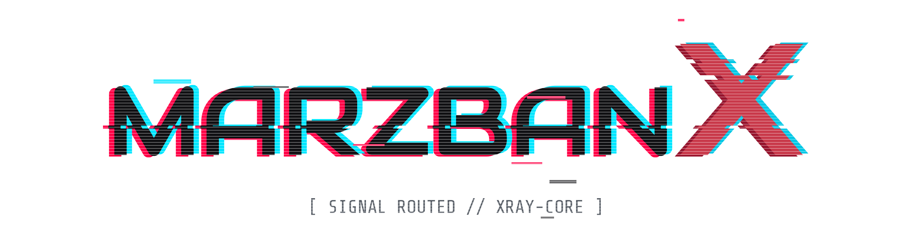

<p align="center">
     <picture>
       <source media="(prefers-color-scheme: dark)" srcset="./assets/logo-dark.png">
       
     </picture>
   </p>

<p align="center">
  Панель управления прокси на базе <a href="https://github.com/XTLS/Xray-core">Xray-core</a> — форк
  <a href="https://github.com/Gozargah/Marzban">Gozargah/Marzban</a> со свежим ядром, новым дизайном и доработками
</p>

<p align="center">
  <a href="https://github.com/DarkSander/MarzbanX/blob/master/LICENSE"></a>
  <a href="https://github.com/DarkSander/MarzbanX"></a>
</p>

## Содержание

- [Что это](#что-это)
- [Чем отличается от Marzban](#чем-отличается-от-marzban)
- [Установка](#установка)
- [Первый вход и HTTPS для панели](#первый-вход-и-https-для-панели)
- [Сертификаты Let's Encrypt через Cloudflare](#сертификаты-lets-encrypt-через-cloudflare)
- [Протоколы](#протоколы)
- [Маршрутизация в подписке (Happ)](#маршрутизация-в-подписке-happ)
- [Команда marzbanx](#команда-marzbanx)
- [Настройки (.env)](#настройки-env)
- [Обновление](#обновление)
- [Резервное копирование](#резервное-копирование)
- [Telegram-бот, ноды, вебхуки](#telegram-бот-ноды-вебхуки)
- [API](#api)
- [Лицензия](#лицензия)

# Что это

MarzbanX — веб-панель для управления пользователями прокси-сервера на Xray: создание пользователей, лимиты трафика и срока действия, ссылки-подписки и QR-коды, статистика. Бэкенд на Python (FastAPI), интерфейс на React.

Возможности, унаследованные от Marzban:

- протоколы **VLESS** и **Shadowsocks**; **TLS** и **REALITY** (см. [Протоколы](#протоколы))
- несколько протоколов на одного пользователя, много пользователей на одном инбаунде, несколько инбаундов на одном порту (fallbacks)
- лимиты по трафику и сроку, периодический сброс трафика (день, неделя, месяц)
- подписки для V2rayNG, v2rayN, Streisand, Happ, sing-box, Clash / Clash Meta
- мониторинг системы и статистика трафика
- Telegram-бот, CLI, REST API, ноды ([Marzban-node](https://github.com/Gozargah/Marzban-node))
- интерфейс на русском, английском, фарси и китайском

# Чем отличается от Marzban

- **Только устойчивые к блокировкам протоколы** — VLESS (RAW/XHTTP/gRPC) и Shadowsocks, включая Shadowsocks 2022. См. [раздел ниже](#протоколы).
- **Свежий Xray-core** — версия задаётся при сборке образа (`XRAY_VERSION` в `Dockerfile`), geoip/geosite берутся из [Loyalsoldier/v2ray-rules-dat](https://github.com/Loyalsoldier/v2ray-rules-dat).
- **Новый дизайн** панели.
- **Сертификаты Let's Encrypt прямо из панели** — выпуск через DNS-01 в Cloudflare, автопродление, установка в инбаунды Xray и в саму панель. См. [раздел ниже](#сертификаты-lets-encrypt-через-cloudflare).
- **Маршрутизация в подписке для Happ / INCY** — клиент сам получает правила «RU сайты напрямую, остальное через прокси». См. [раздел ниже](#маршрутизация-в-подписке-happ).
- **Всё состояние в одном каталоге** — база, конфиг Xray, шаблоны и сертификаты лежат в `/var/lib/marzban` и переживают пересоздание контейнера.
- **Своя установка** — `docker compose` из исходников и короткий скрипт `marzbanx` вместо `Marzban-scripts`. Только SQLite.
- Исправления ошибок оригинального проекта.

# Установка

Нужен сервер с Linux (Ubuntu/Debian), root-доступ и домен — если хотите HTTPS для панели и TLS-инбаунды.

**1. Установите Docker**, если его ещё нет:

```bash
curl -fsSL https://get.docker.com | sh
```

**2. Скачайте проект в `/opt/marzbanx`:**

```bash
git clone https://github.com/DarkSander/MarzbanX.git /opt/marzbanx
cd /opt/marzbanx
```

**3. Создайте файл настроек:**

```bash
cp .env.example .env
nano .env
```

Для первого запуска достаточно значений по умолчанию. Если панель будет открыта только через SSH-туннель (рекомендуется до настройки HTTPS), поставьте:

```env
UVICORN_HOST = "127.0.0.1"
UVICORN_PORT = 8000
```

Остальные переменные описаны в разделе [Настройки](#настройки-env).

**4. Установите команду `marzbanx`:**

```bash
sudo bash /opt/marzbanx/marzbanx.sh install-script
```

**5. Соберите образ и запустите:**

```bash
marzbanx build
marzbanx up
```

Сборка занимает несколько минут: собирается интерфейс и скачивается Xray. После запуска в логе должна появиться строка `Application startup complete`.

**6. Создайте администратора:**

```bash
marzbanx cli admin create --sudo
```

Контейнер работает в режиме `network_mode: host`, поэтому панель и инбаунды Xray слушают порты прямо на сервере. Не забудьте открыть в файрволе порт панели (если она доступна снаружи) и порты ваших инбаундов.

# Первый вход и HTTPS для панели

Пока сертификата нет, панель работает по обычному HTTP, и логин с паролем передаются открытым текстом. Поэтому первый вход лучше делать через SSH-туннель — с вашего компьютера:

```bash
ssh -L 8000:localhost:8000 root@IP_СЕРВЕРА
```

и откройте в браузере `http://localhost:8000/dashboard/`.

Дальше выпустите сертификат для домена панели (см. следующий раздел, галочка «применить к панели») и пропишите его в `.env`:

```env
UVICORN_HOST = "0.0.0.0"
UVICORN_SSL_CERTFILE = "/var/lib/marzban/certs/panel.example.com/fullchain.pem"
UVICORN_SSL_KEYFILE  = "/var/lib/marzban/certs/panel.example.com/key.pem"
```

```bash
marzbanx restart
```

Панель будет доступна по `https://panel.example.com:8000/dashboard/`. При автопродлении панель сама перезапустится и подхватит новый сертификат.

> **Если домен панели проксируется через Cloudflare** (оранжевое облако): Cloudflare пропускает HTTPS только на портах 443, 2053, 2083, 2087, 2096 и 8443. Порт 8000 через прокси работать не будет — поставьте `UVICORN_PORT` на один из этих портов. Домены для VLESS/REALITY и других инбаундов оставляйте в режиме «DNS only» (серое облако).

# Сертификаты Let's Encrypt через Cloudflare

Панель выпускает сертификаты Let's Encrypt по DNS-01: TXT-запись создаётся в Cloudflare через API, поэтому порт 80 открывать не нужно, а домен может быть за прокси Cloudflare.

1. Создайте в Cloudflare API-токен с правом **Zone → DNS → Edit** для нужной зоны.
2. В панели откройте **Certificates**, укажите e-mail для Let's Encrypt и токен. Их же можно задать в `.env` (`ACME_EMAIL`, `CLOUDFLARE_API_TOKEN`) — настройки из панели имеют приоритет.
3. Запросите сертификат для домена и выберите, куда его применить:
   - **инбаунды Xray** — сертификат прописывается в `tlsSettings` выбранных инбаундов, Xray перезапускается (на нодах тоже);
   - **панель** — файлы кладутся в `/var/lib/marzban/certs/<домен>/fullchain.pem` и `key.pem`.
4. Включите **автопродление** — сертификат обновится за `ACME_RENEWAL_THRESHOLD_DAYS` дней (по умолчанию 30) до окончания.

Для тестов используйте staging-сервер Let's Encrypt, чтобы не упереться в лимиты:

```env
ACME_DIRECTORY_URL = "https://acme-staging-v02.api.letsencrypt.org/directory"
```

Для REALITY сертификат не нужен.

# Протоколы

MarzbanX оставляет только то, что держится под DPI:

| Протокол | Транспорт | Защита |
|---|---|---|
| **VLESS** | RAW (TCP) + Vision | REALITY или TLS — основной вариант |
| **VLESS** | XHTTP | REALITY, TLS или через CDN |
| **VLESS** | gRPC | REALITY или TLS |
| **Shadowsocks** | TCP/UDP | шифры `2022-blake3-aes-128-gcm` / `2022-blake3-aes-256-gcm` (SS-2022) или классические AEAD |

VMess, Trojan, Hysteria2, WireGuard и транспорты WebSocket, HTTPUpgrade, mKCP, QUIC, HTTP/2 убраны. Инбаунды с ними панель не обслуживает: при старте в логе появляется предупреждение, а сохранить такой конфиг в Core Settings нельзя. При обновлении миграция удаляет у пользователей записи VMess/Trojan/Hysteria/WireGuard. Тем, у кого после этого не осталось ни одного протокола, выдаётся VLESS — он появится в подписке после её обновления в клиенте.

**Shadowsocks 2022.** Шифр и ключ сервера задаются на инбаунде, ключ сервера генерирует кнопка с замком в Core Settings:

```json
{
  "tag": "Shadowsocks 2022",
  "port": 8388,
  "protocol": "shadowsocks",
  "settings": {
    "method": "2022-blake3-aes-128-gcm",
    "password": "<ключ сервера из генератора>",
    "clients": [],
    "network": "tcp,udp"
  }
}
```

Ключ пользователя вычисляется из его пароля Shadowsocks, поэтому один и тот же пользователь работает и на классических, и на SS-2022 инбаундах. В подписке клиент получает пароль вида `ключ_сервера:ключ_пользователя`. SS-2022 есть в ссылках v2ray, v2ray-json, sing-box и Clash Meta; классический Clash и Outline его не поддерживают и получают только классический Shadowsocks.

> Xray-core 26 помечает любой Shadowsocks и транспорт gRPC как устаревшие и советует VLESS Encryption и XHTTP. Пока они работают, но основным лучше держать VLESS.

# Маршрутизация в подписке (Happ)

Панель может отдавать вместе с подпиской профиль маршрутизации [Happ](https://www.happ.su/main/dev-docs/routing): клиент сам применяет раздельную маршрутизацию (например, RU сайты напрямую, остальное через прокси) без настройки на устройстве. Профиль передаётся в заголовке ответа `routing` в виде `happ://routing/onadd/<base64 JSON>`; INCY его тоже понимает.

Настройка — в меню шапки → **Subscription routing**:

- **Источник:**
  - *RoscomVPN Default* / *RoscomVPN Whitelist* — готовые профили из [hydraponique/roscomvpn-routing](https://github.com/hydraponique/roscomvpn-routing). Скачиваются при сохранении и обновляются раз в сутки; если GitHub недоступен, отдаётся последняя сохранённая копия. Кнопка **Update now** скачивает сразу.
  - *Custom link* — `happ://routing/onadd/...` (добавить и включить) или `happ://routing/add/...` (только добавить в список).
  - *Custom JSON* — профиль Happ (`Name`, `DirectSites`, `ProxySites`, `BlockSites`, ...), ссылку `onadd` панель соберёт сама.
- **Only for Happ / INCY** — отдавать заголовок только клиентам с таким User-Agent.
- В окне видно, что получат клиенты (`DirectSites` / `ProxySites` / `BlockSites`), и размер заголовка. Профили больше `SUB_ROUTING_MAX_HEADER_SIZE` не отправляются (обратные прокси ограничивают размер заголовков), в лог пишется предупреждение.

Проверить, что заголовок уходит:

```bash
curl -sI -A "Happ/2.0" https://<домен>/sub/<токен> | grep -i routing
```

# Команда marzbanx

| Команда | Что делает |
| --- | --- |
| `marzbanx up` | Запустить |
| `marzbanx down` | Остановить |
| `marzbanx restart` | Перезапустить (перечитывает `.env`) |
| `marzbanx status` | Состояние контейнера |
| `marzbanx logs` | Логи в реальном времени |
| `marzbanx cli ...` | CLI панели, например `marzbanx cli admin list`, `marzbanx cli user list` |
| `marzbanx update` | `git pull`, пересборка, перезапуск |
| `marzbanx build` | Пересобрать образ без обновления кода |
| `marzbanx backup` | Архив данных и `.env` |
| `marzbanx edit` / `edit-env` | Редактировать `docker-compose.yml` / `.env` |
| `marzbanx help` | Справка |

Каталог проекта по умолчанию — `/opt/marzbanx`, другой можно задать переменной `MARZBANX_DIR`. Подробнее о командах CLI — в [cli/README.md](./cli/README.md).

# Настройки (.env)

Все переменные с комментариями — в [`.env.example`](./.env.example). После изменения `.env` выполните `marzbanx restart`. Основные:

| Переменная | Описание |
| --- | --- |
| `UVICORN_HOST` / `UVICORN_PORT` | Адрес и порт панели (по умолчанию `0.0.0.0:8000`) |
| `UVICORN_SSL_CERTFILE` / `UVICORN_SSL_KEYFILE` | Сертификат и ключ для HTTPS панели |
| `UVICORN_SSL_CA_TYPE` | `private` для самоподписанного сертификата (по умолчанию `public`) |
| `DASHBOARD_PATH` | Путь к панели (по умолчанию `/dashboard/`) |
| `MARZBAN_DATA_DIR` | Каталог со всем состоянием панели (по умолчанию `/var/lib/marzban`) |
| `SQLALCHEMY_DATABASE_URL` | База данных (по умолчанию `sqlite:////var/lib/marzban/db.sqlite3`) |
| `XRAY_JSON` | Конфиг Xray (по умолчанию `/var/lib/marzban/xray_config.json`) |
| `XRAY_SUBSCRIPTION_URL_PREFIX` | Адрес, с которого строятся ссылки подписки, например `https://sub.example.com` |
| `XRAY_SUBSCRIPTION_PATH` | Путь подписки (по умолчанию `sub`) |
| `XRAY_FALLBACKS_INBOUND_TAG` | Тег инбаунда с fallbacks |
| `XRAY_EXCLUDE_INBOUND_TAGS` | Инбаунды, которыми панель не управляет |
| `SUB_PROFILE_TITLE` / `SUB_SUPPORT_URL` / `SUB_UPDATE_INTERVAL` | Заголовки подписки: название, ссылка на поддержку, интервал обновления в часах |
| `USE_CUSTOM_JSON_DEFAULT` | Отдавать JSON-конфиг всем поддерживаемым клиентам |
| `USE_CUSTOM_JSON_FOR_V2RAYNG` / `_V2RAYN` / `_STREISAND` / `_HAPP` | То же для отдельных клиентов |
| `SUB_ROUTING_MAX_HEADER_SIZE` | Максимальный размер заголовка `routing` для Happ, байт (по умолчанию `3072`) |
| `ACME_EMAIL` | E-mail для Let's Encrypt |
| `CLOUDFLARE_API_TOKEN` | Токен Cloudflare с правом Zone:DNS:Edit |
| `ACME_DIRECTORY_URL` | ACME-сервер (по умолчанию боевой Let's Encrypt) |
| `ACME_RENEWAL_THRESHOLD_DAYS` | За сколько дней до окончания продлевать (по умолчанию `30`) |
| `TELEGRAM_API_TOKEN` / `TELEGRAM_ADMIN_ID` | Токен бота и ID администраторов |
| `TELEGRAM_PROXY_URL` | Прокси для Telegram-бота |
| `DISCORD_WEBHOOK_URL` | Уведомления в Discord |
| `WEBHOOK_ADDRESS` / `WEBHOOK_SECRET` | Адрес(а) вебхуков и секрет в заголовке `x-webhook-secret` |
| `NOTIFY_REACHED_USAGE_PERCENT` / `NOTIFY_DAYS_LEFT` | Когда предупреждать об израсходованном трафике и окончании срока |
| `USERS_AUTODELETE_DAYS` | Удалять истёкших пользователей через N дней (`-1` — выключено) |
| `JWT_ACCESS_TOKEN_EXPIRE_MINUTES` | Срок жизни токена входа в минутах (`0` — бессрочно) |
| `DOCS` | Включить Swagger на `/docs` и `/redoc` |

> Если вы обновляетесь со старой версии форка, где база и конфиг Xray лежали внутри контейнера (`/code/db.sqlite3`, `/code/xray_config.json`), `marzbanx up` и `marzbanx update` сами скопируют их в `/var/lib/marzban` перед пересозданием контейнера.

# Обновление

```bash
marzbanx update
```

Команда подтянет изменения из репозитория, пересоберёт образ и перезапустит панель. Данные в `/var/lib/marzban` не затрагиваются.

Чтобы собрать с другой версией Xray-core, поменяйте `ARG XRAY_VERSION` в `Dockerfile` (или передайте `--build-arg XRAY_VERSION=vX.Y.Z` в `docker compose build`) и выполните `marzbanx build && marzbanx restart`.

# Резервное копирование

```bash
marzbanx backup
```

Создаёт архив `/opt/marzbanx-backups/marzbanx-backup-<дата>.tar.gz` с каталогом `/var/lib/marzban` (база, конфиг Xray, шаблоны, сертификаты) и файлом `.env`. Каталог для архивов можно сменить переменной `MARZBANX_BACKUP_DIR`. Копируйте архивы на другой сервер — восстановление сводится к распаковке на место и `marzbanx up`.

# Telegram-бот, ноды, вебхуки

**Telegram-бот** управляет пользователями и присылает уведомления. Укажите в `.env` `TELEGRAM_API_TOKEN` (от [@BotFather](https://t.me/botfather)) и `TELEGRAM_ADMIN_ID` (свой числовой ID, узнать можно у [@userinfobot](https://t.me/userinfobot)), затем `marzbanx restart`.

**Ноды** — дополнительные серверы с Xray, которыми управляет одна панель. Используется [Marzban-node](https://github.com/Gozargah/Marzban-node), подключение — в панели через меню **Nodes**.

**Вебхуки** — при заданном `WEBHOOK_ADDRESS` панель отправляет POST-запрос с заголовком `x-webhook-secret` при событиях `user_created`, `user_updated`, `user_deleted`, `user_limited`, `user_expired`, `user_disabled`, `user_enabled`. Пример тела:

```json
{"username": "test_user", "action": "user_updated", "enqueued_at": 1680506457.636369, "tries": 0}
```

# API

У панели есть REST API. Чтобы открыть документацию в Swagger UI и ReDoc, поставьте `DOCS=True` и перейдите на `/docs` или `/redoc`.

# Лицензия

[AGPL-3.0](./LICENSE). MarzbanX основан на [Gozargah/Marzban](https://github.com/Gozargah/Marzban) — спасибо его авторам и контрибьюторам.
